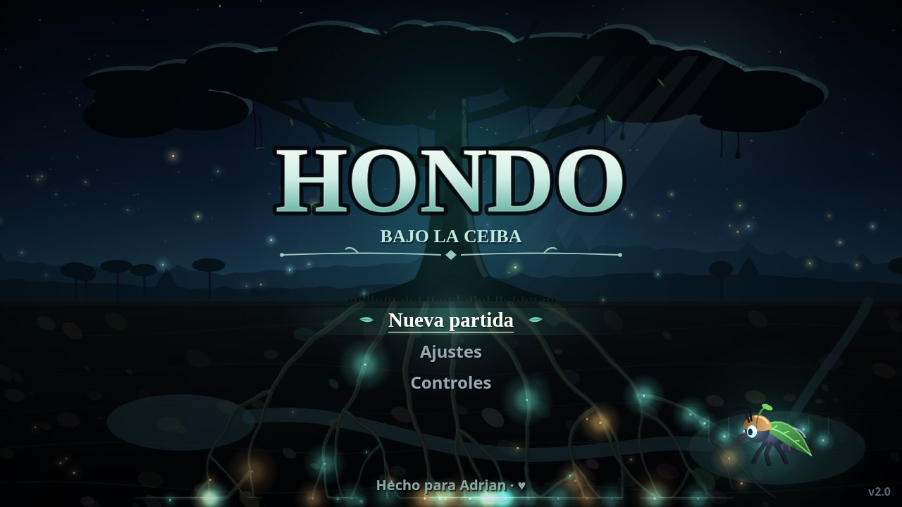
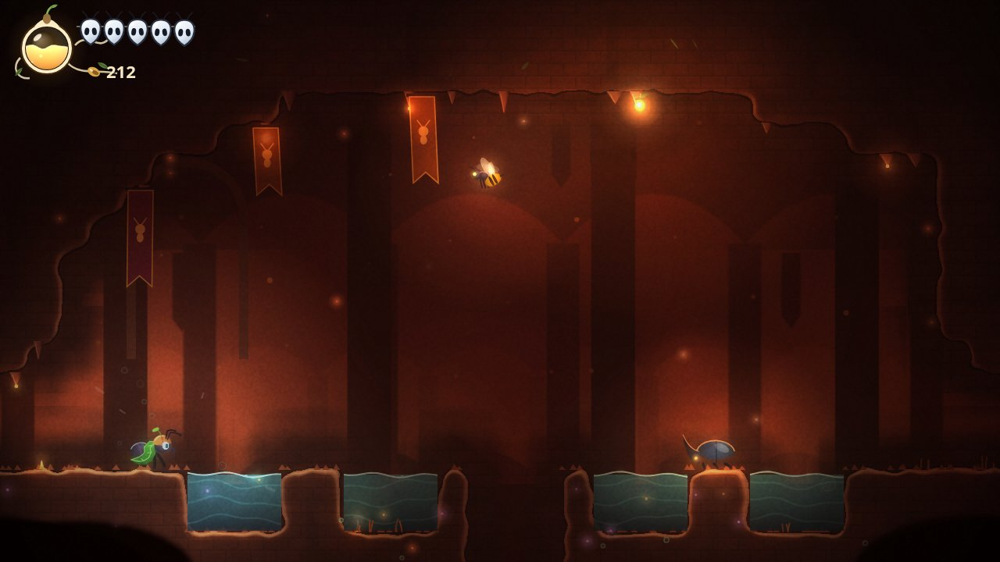

# HONDO — Bajo la Ceiba

A hard, Hollow Knight-style ant Metroidvania, **made for Adrian**. You are Chispa, a tiny ant explorer in a leaf cloak. Descend beneath the great Ceiba through the Root Caverns, the Zompopo Gardens and the Marabunta Depths, and bring the Heart Fungus back to life.

**Play:** https://ale28hn.github.io/hondo/ (works offline once loaded; on phones, hold the device sideways).

## Controls
| Action | Keyboard | Gamepad | Touch |
|---|---|---|---|
| Move | Arrows / WASD | D-pad / stick | Left-side joystick |
| Jump (hold for higher) | Z / Space | A | Jump button |
| Attack (aim with up/down; down in the air = pogo) | X / J | X | Attack (+ joystick up/down) |
| Dash | C / K / Shift | LB / RB / RT | Dash |
| Heal (hold, needs nectar) | A (arrows) / L | B | Heal (hold) |
| Acid spit (once unlocked) | F / U | Y | Acid |
| Map / Pause | Tab, M / Esc, P | Select / Start | Top-right buttons |
| Talk / rest | Up | D-pad up | Joystick up |

Settings include language (Español / English), an assist mode, graphics quality (High / Medium / Low) and the touch controls (Auto / Show / Hide).

The whole game is a single self-contained `index.html` with no external dependencies.
